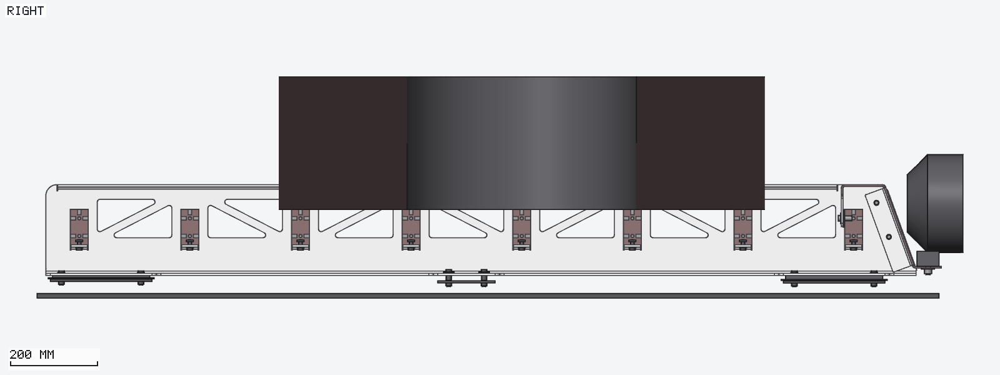

# cad-render-mcp

**Let an AI agent look at, measure and present your CAD models: fast, exact, and without a CAD GUI.**

`cad-render-mcp` is a headless CAD viewer and geometry checker that speaks only
[MCP](https://modelcontextprotocol.io). Point Claude (or any MCP client) at STEP / BREP / IGES files
and it can render them from any angle in milliseconds and return the images inline. It can also
answer exact geometry questions (volume, mass, bend radii, clearances, interference), move parts
around and sweep them through motions, save camera views, and produce photo-realistic stills and
videos.


| CAD-style fly-around (`video`, fast renderer) | Photo-realistic fly-around (`video`, Cycles) |
|---|---|
|  |  |

---

## Why this exists

We designed an aluminium van roof rack in a long Claude session that drove **Autodesk Fusion** through
its MCP add-in. That session had 421 Fusion calls over 4 days. They cost 78 minutes of pure waiting,
26 calls hit the 60 s MCP timeout and 37 errored. Modal dialogs blocked the API, and every screenshot
was written to disk and read back one view at a time.

The agent didn't need a CAD *application*. It needed **eyes and a ruler**. That's what this is:

| Task | Fusion via MCP (measured) | cad-render-mcp (Apple M4) |
|---|---|---|
| Open the 18-part assembly | median 5.4 s, some timeouts | **0.55 s** |
| One screenshot | median 2.7 s (+ file round trip) | **6 ms**, inline |
| Four views | 4 calls + 4 file reads | **14 ms**, one call, one image |
| Interference check | ~15 s per check | **0.4–1.3 s** for the whole assembly |
| Minimum distance | script | **~150 ms** |
| Bend radii, volume, mass | face-loop scripts | **~20 ms** |
| Model changed on disk | re-run scripts | reloaded automatically on the next call |
| Photo-realistic still | (not available) | **2–10 s** (Cycles on Metal) |
| 6 s fly-around video | (not available) | **1 s** CAD style, ~5 min photo quality |

Modelling moves to **geometry-as-code** that exports STEP, e.g.
[build123d](https://github.com/gumyr/build123d) or CadQuery (both OCCT-based, Apache-2.0). Fusion,
FreeCAD, Onshape and SolidWorks exports work just as well. The loop becomes:
**edit model → export → look/measure/check**, with the agent doing the looking.

---

## What it lets you do

### 1. Look at the model, from any angle, in milliseconds

Ask for several views in one call; they come back tiled in one image with view labels and a mm
scale bar (orthographic).


> *"Render iso, back-right iso, right and top."*
> → `render {views: ["iso","iso_br","right","top"]}` (28 ms)

Views: `iso`, `iso_fl/br/bl`, `iso_below`, `front/back/left/right/top/bottom`, any `az<deg>el<deg>`,
or an exact `dir:x,y,z`. Orthographic by default (measurable), `perspective: true` for presentation.

### 2. Focus on what matters

Highlight parts (everything else becomes a faint ghost), label parts, x-ray, line drawings,
close-ups of a region, sections that show the cut faces.

| Highlight + part labels | X-ray, perspective |
|---|---|
|  |  |

| Section through a bar seat: plate, bar, T-nut | Close-up of a 6 × 13 cm region (R25 corner) |
|---|---|
|  |  |


*`style: "lines", edges: "sharp"`: a clean drawing of the laser-cut side plate, ready for a measure sheet.*


*`section {axis: "x", offset: 0}`: the spare wheel cut in half on the bars.*

### 3. Get numbers, never guess from pixels

* **`inspect`**: exact volume, area, mass (`density`), centroid, bounding box, topology, face
  types, and every **cylinder radius** (bend radii, holes) with face counts and areas. That's how we
  check sheet-metal bend radii before a quote.
* **`measure`**: exact minimum distance between two parts, with the closest points.
* **`clash`**: boolean interference volume for every pair whose boxes overlap, plus touching pairs.
  It's robust: fuzzy booleans, a retry ladder, and a point-classification fallback when OCCT's
  boolean silently returns nothing.


*A clash found by `clash`: the T-nut block sits half inside the bar's slot (352 mm³). Here it's a modelling simplification, but now you know.*

### 4. Move things and sweep motions

* **`move`** places parts (translate / rotate about any axis). Renders, measurements and clash
  checks then use the moved positions. Save poses by name and re-apply them later.
* **`motion`** sweeps parts through a movement in N steps. At every step it reports the exact
  clearance to nearby parts and any interference, and the first contact, plus a contact sheet from
  a fixed camera. Motions can be saved and re-run.


*"Can we tip the spare wheel up against the front?" It clears the bars (2.6 → 26 mm), then hits the
front plate at ~75°. Found in 1 s.*


### 5. Repeatable points of view

`save_view` stores the last render, including the **exact camera**, in `.cad-render.json` next to
your model. `render {preset: "lamps"}` reproduces it pixel-for-pixel in any later session, even
after the model changed. That makes before/after comparisons trivial:

| `lamps` view | Same frozen view, front plate + lamps moved up 40 mm |
|---|---|
|  |  |

### 6. Present it: photos and videos

* **`photo`**: path tracing with [Cycles](https://www.cycles-renderer.org) on the GPU (Metal).
  * physical materials (aluminium, brushed aluminium, zinc, steel, stainless, anodised, powder coat,
    rubber, plastic, chrome or any paint), guessed from CAD colours by default;
  * lighting: `studio`, `sky`, or any HDRI file;
  * a floor with soft shadows, filmic tone mapping, denoising.
* **Background images**: put the model on a photo (`background_image`). Its real shadow is measured
  and multiplied onto the photo, so it sits *in* the scene. Works for `render` too.
* **`video`**: record a saved/inline motion and/or an **orbit swoop** as MP4 (hardware H.264 via
  AVFoundation) or GIF.
  * `fast` frames take ~2 ms and have the exact clearance burned into every frame;
  * `photo` frames come from Cycles.

| Studio close-up (`photo`, 128 samples, 10 s) | On a backdrop photo, sun from the side, shadow composited |
|---|---|
|  |  |

---

## How we use it (a typical session)

Condensed from the real roof-rack session (part names shortened, numbers as measured):

```text
you:    Open the rack export and show it from all sides.
claude: open {paths: ["export/rack.step"], split_solids: true}
        render {views: ["iso","front","right","top"]}                 → 4 views, 28 ms

you:    Does the wheel clear the front plate if we tip it up?
claude: motion {parts: ["WHEEL"], rotate: {axis: "x", deg: -85, origin: [0, 2018, 189]},
                steps: 17, save_as: "wheel_tip_up"}
        → clears the bars, first interference with FRONT_PLATE at step 15 (~75°)

you:    Lower the front plate 40 mm and show me the lamp mounts like before.
claude: move {parts: ["FRONT_*", "LAMP*"], translate: [0, 0, -40], save_pose: "fp_down40"}
        render {preset: "lamps"}                                      → identical camera
        measure {a: "FRONT_PLATE:1", b: "BAR_ISB_40x80 (5):8"}         → 4.000 mm

you:    Check every bend radius on the side plate before we send it to the laser cutter.
claude: inspect {parts: ["PLATE_L"], density: 2.66}                   → R4 ×12, R5 ×18 … 6.48 kg

(the model script changes, you re-export; nothing to reload: the next call picks it up)

you:    Make a nice picture and a fly-around for the sales page.
claude: photo {views: ["az-145el24"], materials: {"FEET_HW*": "zinc", "WHEEL": "rubber"}}
        video {orbit: {}, renderer: "photo", seconds: 5}
```

Everything above is a plain MCP tool call. The images come back inline, so the agent sees them
immediately, and so do you in clients that render MCP images.

---

## Install

Requirements: macOS on Apple Silicon (Metal), [Homebrew](https://brew.sh), Rust.

```sh
brew install rust opencascade                 # OCCT 7.9 (LGPL-2.1, used as shared libraries)
git clone https://github.com/Willianvdv/cad-render-mcp && cd cad-render-mcp
scripts/install.sh                            # builds, installs to ~/.local/bin, registers with Claude Code
```

`scripts/install.sh` runs `cargo install` into `~/.local`, copies Cycles (if built, see below) to
`~/.local/share/cad-render-mcp/cycles`, and runs
`claude mcp add --scope user cad-render -- ~/.local/bin/cad-render-mcp`. The tools are then
available in **every** project as `mcp__cad-render__*`. Restart Claude Code (or `/mcp` → reconnect)
afterwards. Re-run the script to update the installed copy; developing in the repo never touches it.

Other MCP clients: run `~/.local/bin/cad-render-mcp` as a stdio server.

### Optional: Cycles for `photo` and photo-quality `video`

```sh
brew install cmake git-lfs && git lfs install
git clone https://projects.blender.org/blender/cycles.git ~/src/cad-render-mcp-deps/cycles
cd ~/src/cad-render-mcp-deps/cycles && make update && make   # ~1.3 GB prebuilt libs; ~1-2 min build
cd - && scripts/install.sh                                   # copies Cycles next to the install
```

The first photo compiles Cycles' Metal kernels (~2 min, once); after that, photos take seconds.
Lookup order: `$CAD_RENDER_CYCLES`, `cycles/` next to the binary,
`~/.local/share/cad-render-mcp/cycles`, `~/src/cad-render-mcp-deps/cycles/install`.

### Try it without your own CAD files

```sh
cad-render-mcp demo-step demo.step     # a small named, coloured assembly (also in examples/)
```

---

## Tool reference

| Tool | What it does |
|---|---|
| `open` | Load files or directories. `split_solids` gives one part per body; `deflection_mm` / `angle_deg` set tessellation; `project` sets the project file. Returns parts with ids, sizes, timings. Changed files reload on every later call. |
| `render` | Tiled views → inline PNG. `views`, `width/height/cols`, `show/hide/highlight/ghost/focus`, `region` (mm box), `zoom`, `colors`, `color_by` (file/part/uniform), `style` (shaded/xray/lines), `edges` (all/sharp/none), `silhouettes`, `section {axis/normal, offset, remove}`, `perspective`, `up` (z/y), `background`, `background_image` + `background_fit`, `labels`, `part_labels`, `scale_bar`, `preset`, `cameras`, `save`. |
| `photo` | Cycles still with the same viewpoint options as `render`, plus the look: `materials`, `samples`, `floor`, `environment` (studio/sky/HDRI path), `environment_strength/rotation/visible`, `background`, `background_image` (real shadow composited), `exposure`. |
| `video` | MP4 (hardware H.264) or GIF of a motion (`run` / `motion`) and/or an `orbit {az/el/zoom from→to}` swoop. `renderer` fast/photo, `fps`, `seconds`, `pingpong`, `hold`, `annotate` (exact clearance per frame), the same look options as `photo`. Returns a contact sheet inline plus the file path. |
| `parts` | List parts (id, assembly path, file, size, triangles). |
| `inspect` | Exact B-rep properties: volume, area, mass, centroid, bbox, topology, face types, cylinder and torus radii. |
| `measure` | Exact minimum distance between two parts, with closest points (respects poses). |
| `clash` | Interference volumes for all overlapping pairs (respects poses); `touching` lists contact pairs. |
| `move` | Translate / rotate parts (`rotate {axis, deg, origin}`), `absolute`, `reset`, apply `pose`, `save_pose`. |
| `motion` | Sweep a translate/rotate in `steps`; per-step clearance/interference, first contact, contact sheet; `save_as` / `run`. |
| `save_view` | Save the last render (all options + exact cameras) by name. |
| `saved` | List or delete saved views, poses and motions. |
| `close` | Unload everything. |

**Part selectors** accept an id (`p12`), an exact name or assembly path (`PLATE_L:1`), a glob
(`BAR_*`), or a substring. **Units** are mm; **named views** assume Z up with `front` looking
along +Y. **Saved views, poses and motions** live in `.cad-render.json` next to the first opened
file, so you can commit them with the model.

---

## How it works

```
STEP/IGES/BREP ─▶ OpenCascade XCAF reader (names, colours, assembly tree)
               ─▶ BRepMesh (parallel) → triangles + normals, B-rep edges (seams dropped,
                  tangent edges flagged), silhouette candidates
               ─▶ GPU buffers (kept resident)          (exact B-rep stays in memory for queries)

render ─▶ wgpu on Metal: one 4× MSAA pass draws every tile
          faces (lit) → feature edges (screen-space quads) → silhouettes (decided per view in the
          vertex shader) → ghosts; sections clip in the fragment shader, back faces = cut caps
       ─▶ one readback → labels/scale bar → PNG → base64, inline in the MCP result

inspect/measure/clash/motion ─▶ OCCT: GProp, BRepExtrema, non-destructive fuzzy booleans;
                                 motion steps run in parallel on all cores

photo/video(photo) ─▶ scene → Cycles standalone (separate process, Metal) → EXR → filmic tone map
video ─▶ AVFoundation/VideoToolbox H.264, or GIF
```

* **Rust** + the official MCP SDK (`rmcp`), stdio transport only. stdout is the protocol, so at
  startup the server moves it to a private fd and points fd 1 at stderr: stray prints from native
  libraries can't corrupt it.
* **OpenCascade 7.9** through a small C++ shim (`cpp/occt_shim.cpp`), linked dynamically.
* All work runs off the async runtime; one scene, one GPU device, resident meshes.

## Development

```sh
cargo build --release
cargo test --release                       # unit tests
python3 tests/e2e_demo.py                  # every tool over real MCP stdio, on examples/demo_rack.step
python3 tests/e2e_roofrack.py              # the original roof-rack suite (needs private testdata/)
cargo run --release -- bench examples/demo_rack.step -o /tmp/bench.png
python3 tests/drive.py calls.json out/     # replay a JSON list of tool calls, save the images
```

CI (GitHub Actions, macOS arm64) runs fmt, clippy `-D warnings`, the unit tests and the demo
end-to-end suite. GPU checks skip automatically when the runner has no Metal device.

The gallery above is generated by `python3 tests/drive.py scripts/gallery_roofrack.json docs/gallery`
(it needs the private roof-rack export in `testdata/`).

## Licence

MIT OR Apache-2.0, at your option. OpenCascade (LGPL-2.1 + Open CASCADE exception) is used as
shared libraries; Cycles (Apache-2.0) runs as a separate process. See [NOTICE.md](NOTICE.md) for what
binary distributions must include.

## Roadmap

* STL/OBJ/glTF input (mesh references such as a scanned van roof for clearance checks)
* keep one Cycles process alive across video frames (today each frame restarts it)
* bundle Cycles in release archives; Linux/Vulkan support (wgpu already supports it)
* face/edge picking and per-face highlights; 2D section profiles with dimensions
