# cad-render-mcp to render CAD files directly into drawings, photorealistic renders, animations and videos

**Input:** a CAD file (STEP, BREP or IGES).

**Output:**

* CAD-style images from any angle, returned inline: shaded, x-ray, section cuts, highlighted or
  ghosted parts, colour by part, on a backdrop photo
* drawings: orthographic front, top and side views with a scale bar, laid out as ISO 128
  first-angle or third-angle sheets with all views at one scale
* photorealistic stills (Cycles) with materials, floor and studio, sky or HDRI lighting
* animations as GIF: orbits around the model and part motions
* videos as MP4, CAD-style or photorealistic
* exact numbers: volume, area, mass, radii, distances, clearances and interference

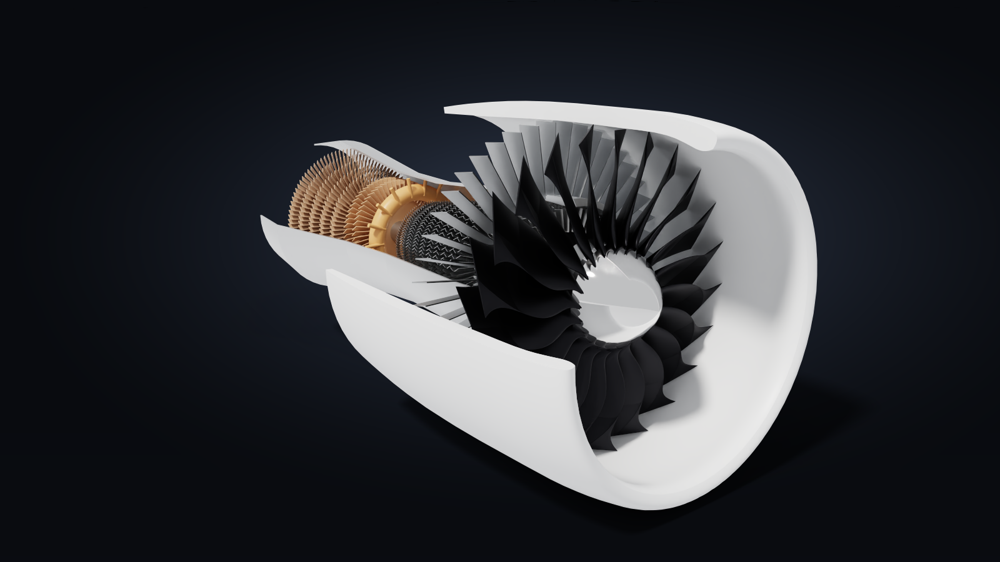

| CAD-style fly-around, both spools turning: 120 frames in 1.5 s | Photo-realistic fly-around (Cycles) |
|---|---|
|  |  |

| Into the intake | The core up close: compressor, combustor ring, turbines (`photo` of a `region`) |
|---|---|
| 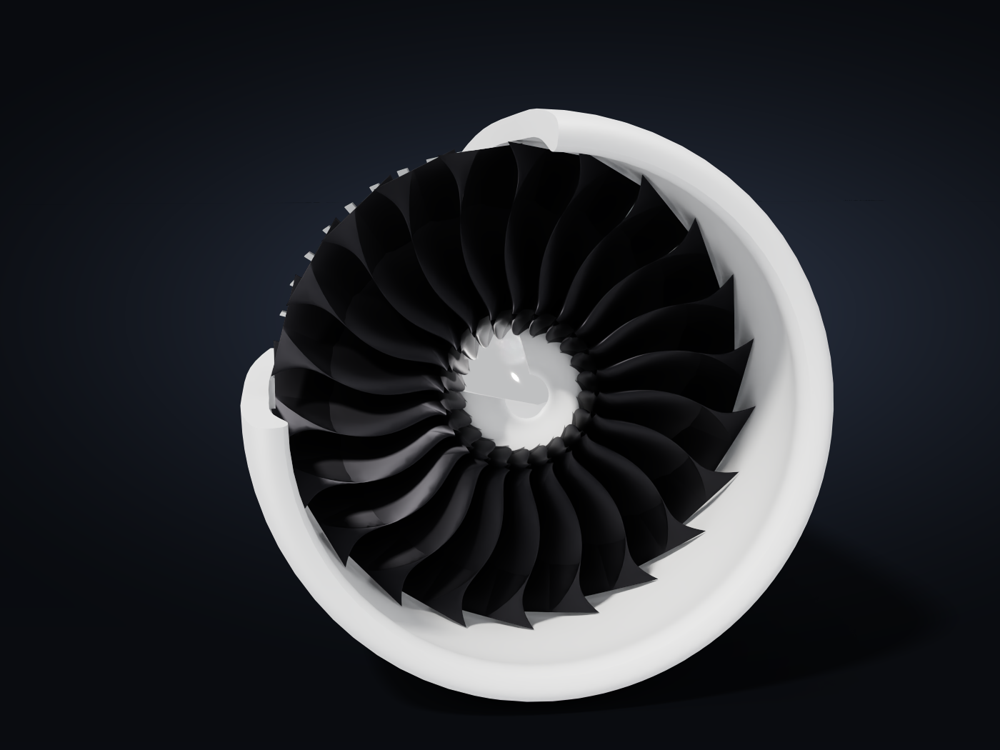 | 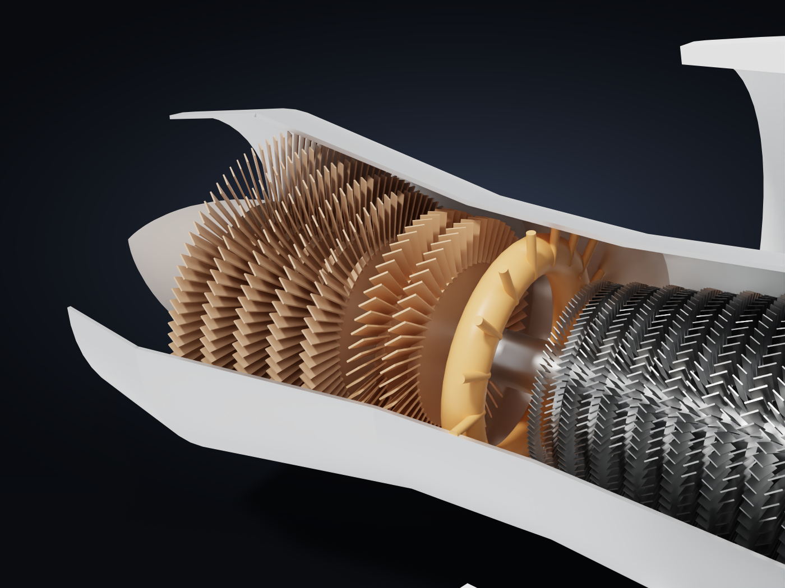 |

| Four views in one call | "Does the fan clear the casing all the way round?" `motion` turns it one blade pitch: 5.02 mm at every step |
|---|---|
| 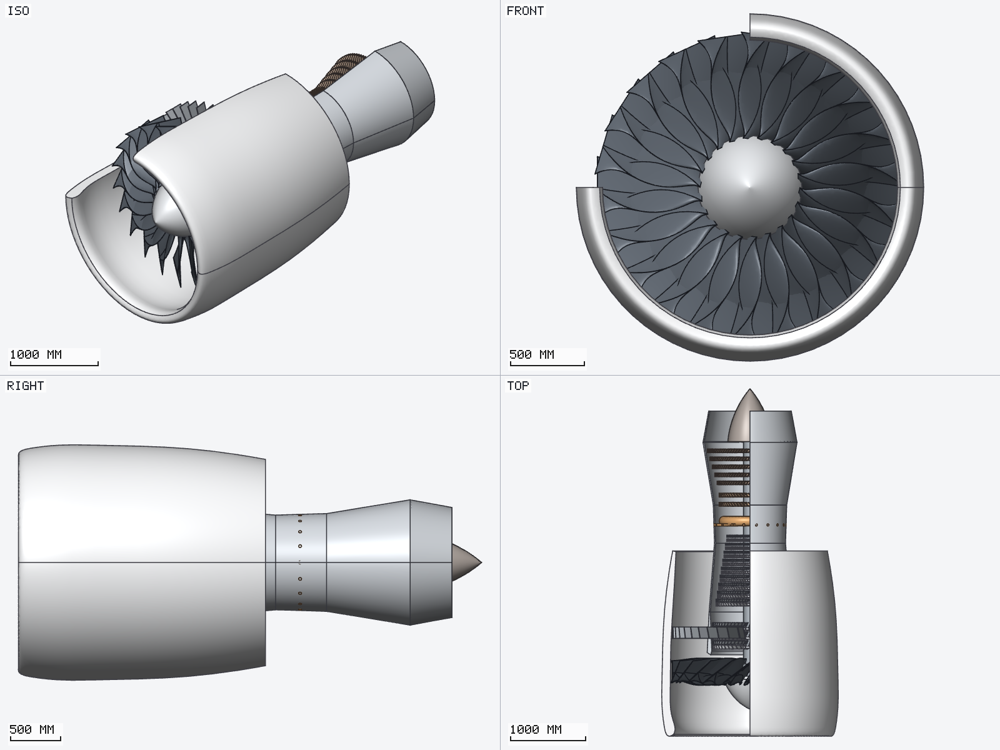 | 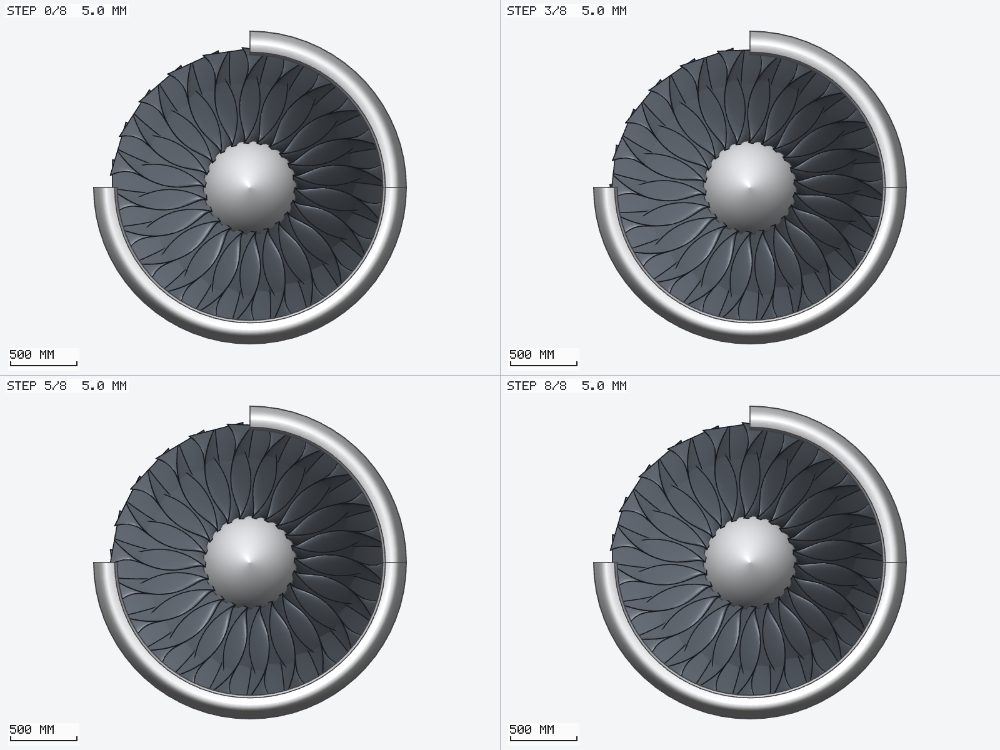 |

| Highlight + labels: both spools and the combustor | X-ray from the side |
|---|---|
| 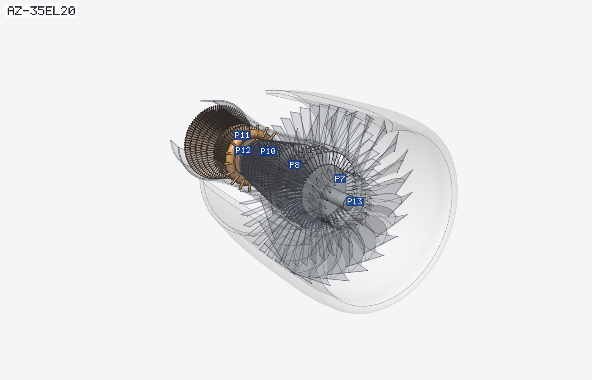 | 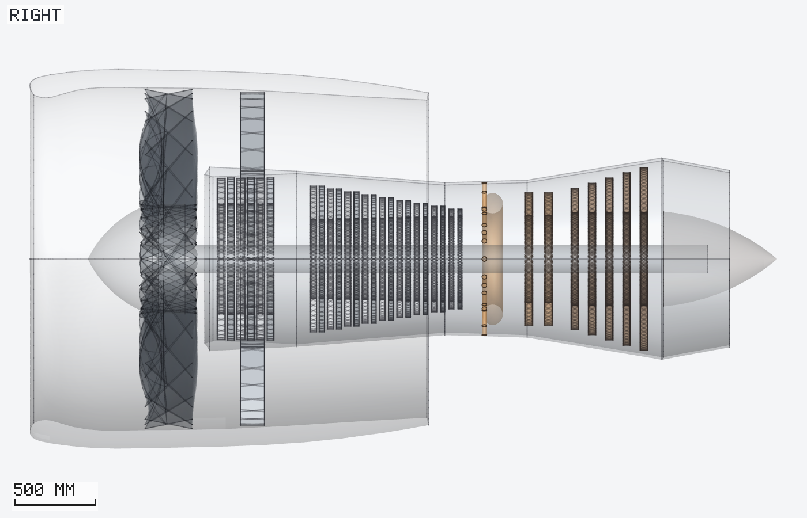 |

| Section: the whole gas path | Close-up of a region, in section: combustor and turbines |
|---|---|
| 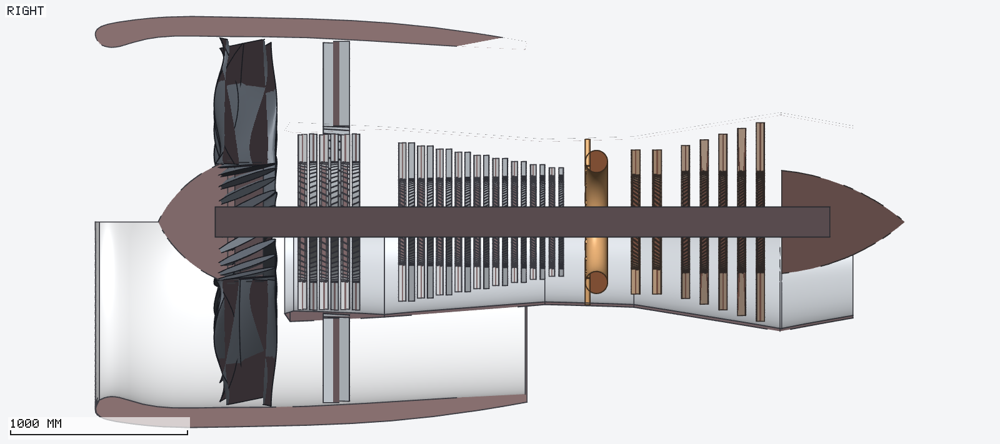 | 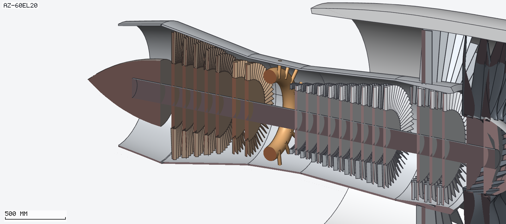 |

| Saved view | Same frozen view, after moving the nacelle 1,600 mm forward |
|---|---|
| 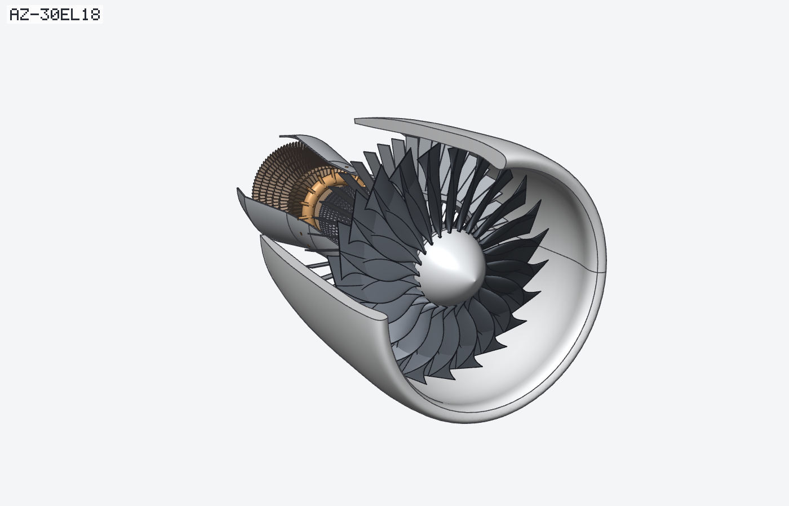 | 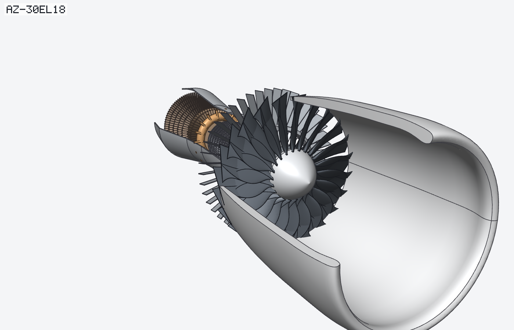 |

| `template: "drawing_first_angle"`: an ISO first-angle sheet | `template: "six_views_third_angle"`: all six views, one scale |
|---|---|
| 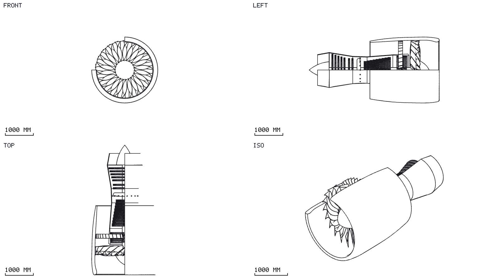 | 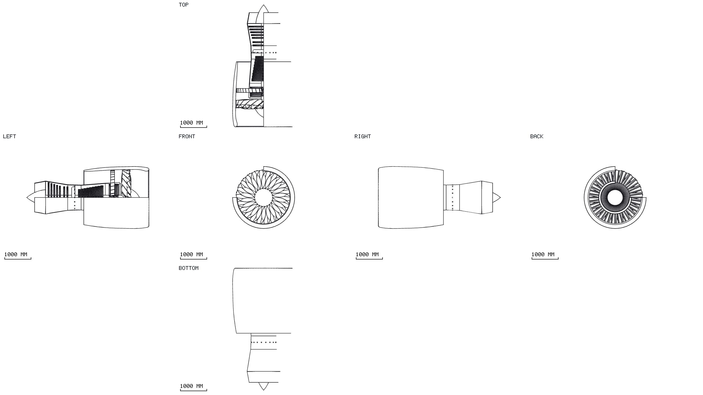 |

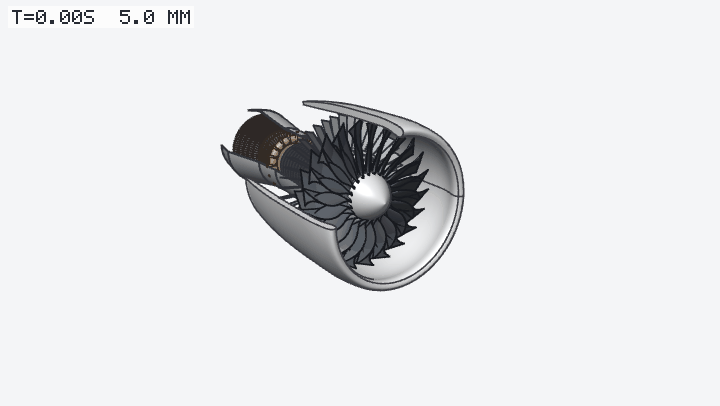
<sub>"Can the nacelle slide forward for maintenance?" `video` checks every frame and burns the result in:
the inlet lip is narrower than the fan, so they clash within the first 14 % of the travel.</sub>

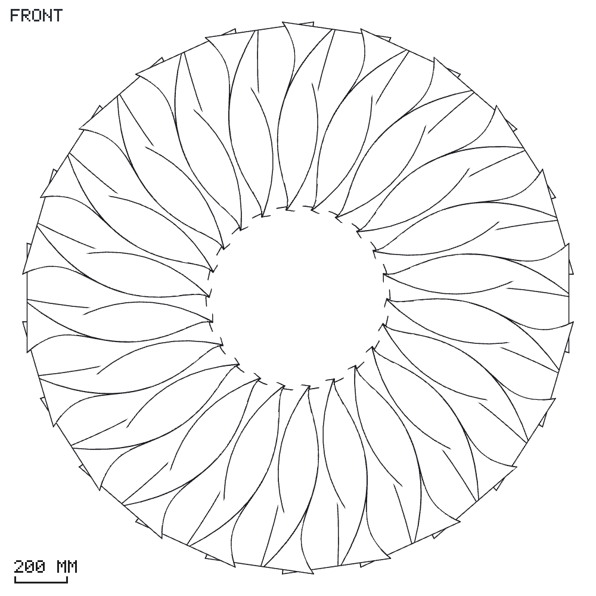
<sub>`style: "lines", edges: "sharp"`: the fan as a clean drawing.</sub>

<sub>All images in this README come from one example model, a cut-away turbofan written in CadQuery
([`examples/turbofan.py`](examples/turbofan.py)): 15 parts, 2,436 aerofoils, 151,104 triangles.
They were made by the tools below, unedited; [`scripts/gallery_turbofan.json`](scripts/gallery_turbofan.json)
makes them again.</sub>

---

**A fast feedback loop for CAD: your AI agent sees, measures and presents your models in milliseconds.**

`cad-render-mcp` is a headless CAD viewer and geometry checker that speaks only
[MCP](https://modelcontextprotocol.io). Give Claude (or any MCP client) a STEP, BREP or IGES file
and it can:

* look at it from any angle and get the image back inline, in about 10 ms;
* ask exact questions (volume, mass, radii, clearances, interference);
* move parts, sweep motions and check them;
* keep camera views so every iteration is seen from the same place;
* produce photo-realistic stills and videos when you need to show it.

It runs headless as a single binary and works straight from your model files.

---

## The loop

```
   edit the model ──▶ export STEP ──▶ agent looks / measures / checks ──▶ decide ──┐
        ▲              (any CAD, or     render 6–30 ms · measure ~20–150 ms ·        │
        │               code: build123d, clash < 1.5 s · reload automatic           │
        └──────────── CadQuery, …)                                                  │
                    ◀──────────────────────────────────────────────────────────────┘
```

The point is iteration speed. Looking, measuring and checking are each one tool call that returns
in milliseconds. That's fast enough for an agent to check its own work after every change:

* **The model is a file.** Export from whatever you use: build123d, CadQuery, FreeCAD, Onshape,
  SolidWorks, or KiCad (STEP of a PCB). `open` it once; every later call reloads the
  file if it changed on disk, with stable part ids.
* **Seeing is cheap.** `render` returns several views tiled in one image, inline in the tool
  result, with a mm scale bar.
* **Numbers are exact.** `inspect`, `measure` and `clash` query the real B-rep through
  OpenCascade, so the agent works with exact dimensions.
* **Views are repeatable.** `save_view` freezes a camera; `render {preset}` shows the next
  iteration from exactly the same point, so differences jump out. Templates give every model the
  same set of views.
* **Movement is checkable.** `motion` sweeps parts through a movement and reports the clearance at
  every step, so a "does it fit / does it open / does it hit" question is one call.

Geometry-as-code tools like [build123d](https://github.com/gumyr/build123d) and CadQuery
(Apache-2.0, also OpenCascade-based) fit this loop especially well: the agent edits the script,
re-runs it, and calls `render`.

### How fast (Apple M4, an 18-part / 265-body assembly, 77k triangles)

| Step | Time |
|---|---|
| `open` (read STEP, tessellate, upload to GPU) | 0.55 s |
| `render` one 1200×900 view | 6 ms |
| `render` four views in one image | 14 ms |
| `render` with section / x-ray / highlight / backdrop image | 5–25 ms |
| `inspect` (volume, mass, radii) | ~20 ms |
| `measure` (exact minimum distance) | ~150 ms |
| `clash` over the whole assembly | 0.4–1.3 s |
| `motion`, 17 steps with exact clearance | ~1 s |
| `video`, 6 s orbit at 30 fps (CAD style) | 1 s |
| `photo` 1200×750, 32 samples | ~3 s (first run compiles kernels once, ~2 min) |

---

## What you can do

### Look: any view, any style, in one call

```json
render {"views": ["iso", "iso_br", "right", "top"]}
```

* **Views:** `iso`, `iso_fl/br/bl`, `iso_below`, `front/back/left/right/top/bottom`, any
  `az<deg>el<deg>`, or an exact `dir:x,y,z`. Orthographic (measurable, scale bar) by default;
  `perspective: true` for presentation.
* **Focus:** `show`, `hide`, `highlight` (everything else ghosted), `ghost`, `focus` (frame these
  parts), `region` (frame an mm box for a close-up), `zoom`.
* **Style:** `shaded`, `xray`, `lines` (clean drawings), `edges: all/sharp/none`, part `colors`
  or `color_by: part`, `part_labels` with a legend.
* **Sections:** `section {axis|normal, offset}`. The half facing the camera is removed, so the cut
  faces always show.
* **Backgrounds:** a colour, transparent, or `background_image` (put the model on a photo).

### Measure: exact numbers from the B-rep

* **`inspect`**: volume, area, mass (`density`), centroid, bounding box, topology, face types,
  and every **cylinder and torus radius** with face counts, e.g. sheet-metal bend radii and hole
  sizes.
* **`measure`**: exact minimum distance between two parts, with the closest points.
* **`clash`**: interference volume for every overlapping pair, optionally the touching pairs. It
  uses fuzzy booleans, a retry ladder and point classification to confirm every contact.

### Move: poses and motions

* **`move`**: translate or rotate parts about any axis. Renders, measurements and clash checks use
  the moved positions. Save a pose by name and re-apply it later.
* **`motion`**: sweep parts through a movement in N steps. Each step reports the exact clearance to
  nearby parts and any interference, then the first contact, with a contact sheet from a fixed
  camera. Save it and re-run it after every model change.

### Compare: frozen views

`save_view` stores the last render (all options plus the exact camera) in `.cad-render.json` next
to the model; `render {preset: "name"}` reproduces it pixel-for-pixel in any later session, even
after the model changed.

### Templates: the same views for every model

A template is a render setup (views, layout, style, size) that works on any model. Use one with
`render {template: "name"}`; anything else you pass overrides it. `photo` takes a template too,
and so do the `render` options of `video` and `motion`.

| Built-in | What you get |
|---|---|
| `overview` | Isometric, front, right and top, each with a scale bar |
| `drawing_first_angle` | ISO 128 first-angle sheet: front, the left view to its right, top view below, isometric in the corner |
| `drawing_third_angle` | ISO 128 third-angle sheet: top view above the front, the right view to its right, isometric in the corner |
| `six_views_first_angle` / `six_views_third_angle` | All six principal views arranged around the front view |
| `turnaround` | Eight perspective views all the way around, every 45° |
| `presentation` | One large perspective view without labels, for slides and docs |

In the drawing templates the principal views share one scale and one centre (`same_scale`), so
heights line up across a row and widths down a column, as on a drawing sheet. An empty string in
`views` leaves a tile blank.

**Your own templates** are JSON files named `<name>.json`:

```json
{
  "description": "Side elevation for the brochure",
  "render": {"views": ["right"], "style": "lines", "edges": "sharp", "width": 1800, "height": 600}
}
```

`save_view {name, template: "user"}` turns the last render into one. They are read from, in this
order (the first match wins, so a file can replace a built-in):

1. `cad-render-templates/` next to the project file, to share with the model (`template: "project"`);
2. every folder in `$CAD_RENDER_TEMPLATES` (colon-separated), e.g. a team library;
3. `~/.config/cad-render-mcp/templates/`, your personal library (`template: "user"`);
4. the built-ins.

Files are read on every call, so edits apply immediately. An unknown option in a template is an
error that names it. `saved` lists every template with its source.

### Present: photos and videos

* **`photo`** path traces with [Cycles](https://www.cycles-renderer.org) on the GPU (Metal):
  * physical materials (aluminium, brushed aluminium, zinc, steel, stainless, anodised, powder
    coat, rubber, plastic, chrome, or any paint), guessed from the CAD colours by default;
  * environments: `studio`, `sky`, or any HDRI;
  * a floor with soft shadows, filmic tone mapping and denoising.
* **On a photo:** `background_image` composites the model over your picture, and its shadow is
  measured and applied to the picture, so it sits *in* the scene.
* **`video`** records a motion and/or an orbit swoop to MP4 (hardware H.264 via AVFoundation) or
  GIF:
  * `fast` frames take about 2 ms each and carry the exact clearance burned in;
  * `photo` frames come from Cycles.

---

## A session, condensed

```text
you:    Open the export and show it from all sides.
agent:  open {paths: ["out/assembly.step"], split_solids: true}
        render {views: ["iso", "front", "right", "top"]}

you:    Is anything colliding?
agent:  clash {touching: true}                   → one real overlap: BOLT vs PLATE_L, 439.8 mm³

you:    Show me that spot, and save the view.
agent:  render {region: [...], highlight: ["BOLT", "PLATE_L"], style: "xray"}
        save_view {name: "bolt"}

        … you change the hole size and re-export; the next call picks it up …

agent:  render {preset: "bolt"}                  → same camera, new geometry
        clash {parts: ["BOLT", "PLATE_L"]}       → clear
        inspect {parts: ["PLATE_L"]}             → hole radius 8.5 mm

you:    Does the lid open fully?
agent:  motion {parts: ["LID"], rotate: {axis: "x", deg: -110, origin: [0, 0, 120]}, steps: 22}
        → first contact at step 19 (95°) with HINGE_STOP

you:    Make a picture and a turntable for the docs.
agent:  photo {views: ["az-35el25"], materials: {"LID": "anodised_black"}}
        video {orbit: {}, renderer: "photo", seconds: 5}
```

Every line is a single MCP tool call. Images come back inline, so the agent sees them immediately,
and so do you in clients that display MCP images. The clash numbers come from the bundled demo
model (`examples/demo_rack.step`); the rest is illustrative.

---

## Install

Requirements: macOS on Apple Silicon (Metal), [Homebrew](https://brew.sh), Rust.

```sh
brew install rust opencascade            # OpenCascade 7.9, used as shared libraries (LGPL-2.1)
git clone https://github.com/Willianvdv/cad-render-mcp && cd cad-render-mcp
scripts/install.sh                       # build, install to ~/.local/bin, register with Claude Code
```

`scripts/install.sh` does three things:
1. `cargo install`s the server into `~/.local`;
2. copies Cycles, if built, to `~/.local/share/cad-render-mcp/cycles`;
3. runs `claude mcp add --scope user cad-render -- ~/.local/bin/cad-render-mcp`.

The tools are then available in every project as `mcp__cad-render__*`; restart Claude Code (or
`/mcp` → reconnect). Re-run the script to update. Other MCP clients can start
`~/.local/bin/cad-render-mcp` as a stdio server.

**Optional: Cycles for `photo` and photo-quality `video`**

```sh
brew install cmake git-lfs && git lfs install
git clone https://projects.blender.org/blender/cycles.git ~/src/cad-render-mcp-deps/cycles
cd ~/src/cad-render-mcp-deps/cycles && make update && make   # ~1.3 GB prebuilt libraries, ~1–2 min build
cd - && scripts/install.sh
```

Lookup order: `$CAD_RENDER_CYCLES`, `cycles/` next to the binary,
`~/.local/share/cad-render-mcp/cycles`, `~/src/cad-render-mcp-deps/cycles/install`.

**Try it right away:** `cad-render-mcp demo-step demo.step` writes a small named, coloured
assembly (also in `examples/`).

---

## Tool reference

| Tool | What it does |
|---|---|
| `open` | Load files or directories. `split_solids` gives one part per body; `deflection_mm`/`angle_deg` set tessellation; `project` sets the project file. Changed files reload on every later call. |
| `render` | Tiled views → inline PNG. `views`, `width/height/cols`, `show/hide/highlight/ghost/focus`, `region`, `zoom`, `colors`, `color_by`, `style`, `edges`, `silhouettes`, `section`, `perspective`, `up`, `background`, `background_image`/`background_fit`, `labels`, `part_labels`, `scale_bar`, `template`, `preset`, `cameras`, `same_scale`, `grid`, `save`. |
| `photo` | Cycles still, same viewpoint options as `render`, plus `materials`, `samples`, `floor`, `environment` (studio/sky/HDRI), `environment_strength/rotation/visible`, `background`, `background_image`, `exposure`. |
| `video` | MP4/GIF of a motion (`run`/`motion`) and/or an `orbit` swoop; `renderer` fast/photo, `fps`, `seconds`, `pingpong`, `hold`, `annotate`, plus the `photo` look options. Returns a contact sheet inline plus the file path. |
| `parts` | List parts: id, assembly path, file, size, triangles. |
| `inspect` | Volume, area, mass, centroid, bbox, topology, face types, cylinder/torus radii. |
| `measure` | Exact minimum distance between two parts, with the closest points. |
| `clash` | Interference volume for every overlapping pair; `touching` adds contact pairs. |
| `move` | Translate/rotate parts, `reset`, apply or `save_pose`. |
| `motion` | Sweep a translate/rotate in `steps`; clearance and interference per step, first contact, contact sheet; `save_as`/`run`. |
| `save_view` | Save the last render with its exact cameras, or with `template: "user"`/`"project"` as a template for any model. |
| `saved` | List or delete saved views, poses and motions; lists the templates and their folders. |
| `close` | Unload everything. |

* **Part selectors:** an id (`p12`), an exact name or assembly path, a glob (`BAR_*`), or a
  substring.
* **Conventions:** units are mm, Z is up, `front` looks along +Y; `up: "y"` handles Y-up models.

---

## How it works

```
STEP/IGES/BREP ─▶ OpenCascade XCAF reader (names, colours, assembly tree)
               ─▶ BRepMesh (parallel): triangles + normals, B-rep edges (seams dropped,
                  tangent edges flagged), silhouette candidates   ─▶ GPU buffers (resident)
                                                                     exact B-rep kept for queries
render  ─▶ wgpu on Metal: one 4× MSAA pass draws all tiles: lit faces, screen-space edges,
           per-view silhouettes (vertex shader), ghosts, section caps ─▶ one readback ─▶ PNG inline
inspect / measure / clash / motion ─▶ OpenCascade (GProp, BRepExtrema, non-destructive fuzzy
           booleans); motion steps run in parallel on all cores
photo   ─▶ Cycles standalone (separate process, Metal) ─▶ EXR ─▶ filmic tone map (+ backdrop/shadow)
video   ─▶ AVFoundation / VideoToolbox H.264, or GIF
```

* **Rust** with the official MCP SDK (`rmcp`) over stdio.
* **stdout is the protocol.** At startup the server moves it to a private fd and points fd 1 at
  stderr, which keeps the protocol stream clean.
* **OpenCascade 7.9** through a small C++ shim (`cpp/occt_shim.cpp`), linked dynamically.
* **One scene, one GPU device.** Meshes stay resident between calls. The geometry tools also run on
  CPU-only machines.

## Development

```sh
cargo build --release && cargo test --release
python3 tests/e2e_demo.py              # every tool over real MCP stdio, on examples/demo_rack.step
python3 tests/drive.py calls.json out/ # replay a JSON list of tool calls and save the images
python3 examples/turbofan.py examples/turbofan.step       # the README model (needs CadQuery)
python3 tests/drive.py scripts/gallery_turbofan.json /tmp/g  # README images: stills to /tmp/g, GIFs to docs/gallery
cargo run --release -- bench examples/demo_rack.step -o /tmp/bench.png
```

CI (GitHub Actions, macOS arm64) runs fmt, clippy `-D warnings`, the unit tests and the end-to-end
suite. The security workflow scans the full git history for leaked secrets (gitleaks), checks every
dependency for advisories, licences and sources (`cargo deny check`, policy in `deny.toml`), and runs
CodeQL. Dependabot keeps crates and actions up to date.

## Related

| Project | What it is |
|---|---|
| [**shaper-export-mcp**](https://github.com/Willianvdv/shaper-export-mcp) | Export CAD geometry to Shaper Origin SVG over MCP, with the exact cut-type colour encoding (exterior / interior / pocket / guide / on-line). |

## Licence

MIT OR Apache-2.0, at your option. OpenCascade (LGPL-2.1 + Open CASCADE exception) is used as
shared libraries; Cycles (Apache-2.0) runs as a separate process. See [NOTICE.md](NOTICE.md).
